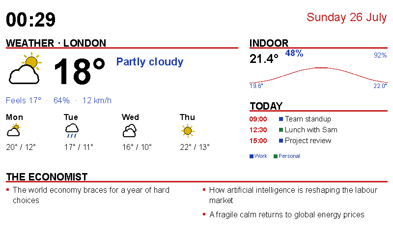

# inky-dash

A self-hosted e-ink dashboard for a Raspberry Pi driving a **Pimoroni Inky
Impression Spectra 7.3"** (800×480, six-colour) display, with a web app for
configuring what it shows.



The panel above is composed from live data: local weather with a multi-day
forecast (Open-Meteo), indoor temperature/humidity from a **Govee H5075** sensor
picked up passively over Bluetooth LE, today's + upcoming **Google Calendar**
events, and headlines from **The Economist** (public RSS). A temperature trend
sparkline is drawn from readings logged to SQLite. It can also be a photo frame:
pictures from **Google Photos** (or uploaded straight from the web UI) are stored
on the device and rotated on a schedule.

## Contents

- [Hardware](#hardware)
- [How it works](#how-it-works)
- [Repository layout](#repository-layout)
- [Local development (no hardware needed)](#local-development-no-hardware-needed)
- [Configuration](#configuration)
- [Data sources](#data-sources)
- [Setting up the Raspberry Pi](#setting-up-the-raspberry-pi)
- [Deploying updates](#deploying-updates)
- [Operating the service](#operating-the-service)
- [E-ink rendering notes](#e-ink-rendering-notes)
- [Development reference](#development-reference)

## Hardware

| Device | Role | Notes |
|---|---|---|
| Raspberry Pi Zero 2 W | Host | Any Pi works; the Zero 2 W's 512MB RAM is enough for the service but **not** for building the frontend — builds happen on your dev machine. |
| Pimoroni [Inky Impression Spectra 7.3"](https://shop.pimoroni.com/products/inky-impression-7-3) | Display | 800×480, six colours (black/white/red/yellow/green/blue). Sits on the GPIO header; needs SPI + I2C enabled. A full refresh takes ~30s with visible flashing — this is normal for colour e-ink. |
| Govee H5075 | Temperature/humidity sensor | No pairing or connection needed: the sensor broadcasts readings inside its BLE advertisements and the dashboard just listens. Place it anywhere in Bluetooth range of the Pi. |

The display model is auto-detected via its EEPROM (`inky.auto`), so other Inky
Impression sizes should work — the only Spectra-specific assumption is the
800×480 resolution in `backend/src/inky_dash/config.py` (`RESOLUTIONS`).

## How it works

One Python process (FastAPI + uvicorn) on the Pi does everything:

```
Govee H5075 ──BLE adverts──> listener task ──> SQLite (backend/data/inky-dash.db) ─┐
Open-Meteo / Economist RSS / Google Calendar ──> module fetch (per-module TTL) ────┤
                                                                                   v
     config.json <──> Pydantic AppConfig <──── web UI (/api/config) ────> render loop
                                                                                   v
                                                       Pillow image (800×480 RGB)
                                                                                   v
                                            Display protocol: InkyDisplay | FileDisplay
```

- **Render loop** — an asyncio task re-renders every `refresh_seconds`
  (default 600). Saving config in the web UI or hitting `POST /api/refresh`
  wakes it immediately. The blocking ~30s hardware refresh runs in an executor
  so the API stays responsive.
- **Playlist** — instead of sitting on one layout, the display can cycle a list
  of screens, each shown for its own dwell time in minutes. The loop shortens
  its sleep so a tick lands when the current screen's time is up; `POST
  /api/playlist/next` skips ahead. Off by default.
- **Modules** — each panel (`weather`, `govee`, `calendar`, `economist`,
  `clock`, `moon`, `xkcd`, `vox`, `photos`) pairs a `fetch()` (data, cached
  per-module) with a `render()`
  (Pillow drawing into its layout slot). Adding a panel = one file in
  `backend/src/inky_dash/modules/` plus a registry entry.
- **BLE listener** — a background task using `bleak`. The H5075 encodes
  temperature/humidity/battery in manufacturer data (company id `0xEC88`) of its
  advertisements; readings are throttled (default: one per 2 minutes) into
  SQLite, which feeds both the on-screen sparkline and the web UI's trend charts.
- **Display abstraction** — a `Display` protocol with two implementations:
  `InkyDisplay` (real hardware; the `inky` package is only installed on the Pi
  via the `pi` extra and only imported lazily) and `FileDisplay` (writes
  `output/display.png`), so the whole stack runs on a laptop with no hardware.
- **Web UI** — React (Vite + TypeScript) single-page app: layout editing and
  panel assignment, the playlist of screens, per-module settings, a live preview
  rendered server-side (`/api/preview.png` — identical output to the physical
  panel, and it follows whichever layout or playlist screen you're editing), and
  sensor trend charts. In production the backend serves the pre-built
  `frontend/dist` at `/`.

## Repository layout

```
backend/                  Python package (uv, FastAPI)
  src/inky_dash/
    main.py               app factory; starts render loop + BLE listener
    loop.py               Dashboard state + render loop
    api.py                /api/* endpoints
    config.py             AppConfig (Pydantic) <-> config.json
    display/              Display protocol, InkyDisplay, FileDisplay
    modules/              one file per dashboard panel + shared drawing helpers
    layout.py             layout templates -> pixel rects
    storage.py            SQLite sensor log
    govee_ble.py          BLE advertisement listener + H5075 parser
    google_auth.py        one-time Google OAuth helper (run on dev machine)
  tests/                  pytest suite (parsers tested against fixtures, no network)
frontend/                 Vite + React + TS config UI (ships as built dist/)
setup.sh                  interactive first-time setup: Pi prep + deploy + service
deploy.sh                 test + build + rsync + restart, from dev machine to Pi
CLAUDE.md                 architecture/commands notes for AI-assisted development
PLAN.md                   build plan and status
```

Runtime state — `config.json`, `data/` (SQLite DB + Google tokens), `output/`
(simulator frames) — lives beside the backend, is gitignored, and survives
every deploy.

## Local development (no hardware needed)

Prerequisites: [uv](https://docs.astral.sh/uv/) (fetches the pinned Python 3.11
itself) and Node 20+.

```bash
# backend — serves API on :8000 and renders frames to output/display.png
cd backend
uv sync
INKY_DASH_DISPLAY=file uv run uvicorn inky_dash.main:app --reload

# frontend — dev server on :5173, proxies /api to :8000
cd frontend
npm install
npm run dev
```

Open http://localhost:5173. The preview image in the UI is the exact frame the
physical display would show. BLE listening works on macOS too (grant the
Bluetooth permission when prompted), so a nearby H5075 will start logging
readings during development.

## Configuration

All configuration lives in one JSON file (default `config.json`, created on
first save) edited through the web UI or `GET/PUT /api/config`. Highlights:

| Key | Default | Meaning |
|---|---|---|
| `refresh_seconds` | `600` | Display refresh cadence. Don't go aggressive — a full colour refresh takes ~30s and flashes. |
| `display.kind` | `auto` | `auto` tries real hardware then falls back to the PNG simulator; `inky`/`file` force one. |
| `display.saturation` | `0.5` | Passed to the inky driver's dithering (0 muted → 1 saturated). |
| `fetch.weather_minutes` etc. | `15`/`15`/`30` | Minutes between upstream fetches for weather / calendar / headlines. Effective cadence rounds up to the next display cycle. |
| `layout.active` | `dashboard_clock` | Layout shown when no playlist is running: a built-in preset id (`full`, `split`, `main_sidebar`, `grid`, `dashboard`, `dashboard_clock`) or one of your own. |
| `layout.layouts` | `[]` | Your custom layouts — regions on a 50×30 cell grid, each optionally hosting one module. Edited with the drag-and-drop grid editor. |
| `playlist.enabled` | `false` | Cycle through screens instead of sitting on `layout.active`. |
| `playlist.items` | `[]` | Ordered screens: `{layout, minutes, enabled}`. Disabled entries (and any pointing at a deleted layout) are skipped; if nothing is left to cycle, `layout.active` is shown. |
| `weather.latitude/longitude` | London | Open-Meteo needs coordinates only — no API key. |
| `weather.show_hourly` | `false` | Adds a strip of upcoming hours (icon, temperature, rain chance) above the daily forecast, from the hour in progress. Times are local to the weather location, not to the Pi. |
| `weather.hourly_hours` | `8` | How many hours ahead that strip covers; a narrower panel fits fewer columns. |
| `govee.mac` | `null` | Optional address filter; `null` accepts any H5075 heard. |
| `govee.trend_hours` | `24` | Window for the on-screen sparkline. |
| `govee.average_minutes` | `0` | `0` shows live readings (panel redraws nearly every cycle). N shows averages over completed N-minute windows, so the panel only triggers an e-ink refresh when a window completes. |
| `moon.show_phases` | `true` | Strip of upcoming principal phases (new / first quarter / full / last quarter) with their dates, under today's moon. |
| `moon.show_rise_set` | `true` | Moonrise and moonset for today, at the weather panel's coordinates. Either can read `—`: about one day a month genuinely has no moonrise. |
| `moon.hemisphere` | `auto` | Which way round the terminator goes. `auto` takes it from the sign of `weather.latitude`. |
| `economist.sections` | `the-world-this-week, leaders` | Section slugs from economist.com URLs. |
| `calendar.calendar_ids` | `[]` | Calendar ids to show. Empty = every calendar selected (checked) in the Google Calendar sidebar, shared calendars included. |
| `photos.mode` | `shuffle` | `shuffle`, `sequential`, or `on_this_day`. |
| `photos.rotate_minutes` | `60` | How long each photo stays up. Rounds up to the next display refresh. |
| `photos.max_photos` | `200` | Pool cap; oldest dropped first. Photos are stored at ~1600×960, roughly 250 kB each. |
| `photos.drive_folder` | `""` | Google Drive folder to mirror (link or id). Empty disables the sync. |
| `photos.drive_sync_minutes` | `60` | How often that folder is checked for new photos. |

Environment variables (all optional): `INKY_DASH_CONFIG` (config file path),
`INKY_DASH_DISPLAY` (override `display.kind`), `INKY_DASH_OUTPUT` (simulator
PNG path), `INKY_DASH_DATA` (data directory for the DB and Google tokens).

## Data sources

### Weather — Open-Meteo

Works out of the box; free, no API key. Set your coordinates and location name
in the web UI. The panel shows current conditions plus a multi-day forecast, and
optionally an hourly strip for the rest of today ("Show hourly forecast for
today" in the widget settings).

### The Economist — public RSS

Headlines come from the public per-section feeds
(`https://www.economist.com/<section>/rss.xml`) — no account or login is
involved. Configure section slugs in the UI; headlines are interleaved
round-robin across sections so one feed can't crowd out the others.

### Moon — nothing to fetch

The lunar panel is computed on the Pi from the clock alone (`astro.py`, truncated
Meeus series), so it keeps working with the network down and has no fetch
interval. It draws today's moon with a true terminator, the phase name and
percentage lit, where the day sits in the ~29.5-day cycle, moonrise/moonset, and
a strip of the upcoming principal phases with their dates. Moonrise and the side
of the disc that's lit both depend on where you are, and they use the **weather
panel's coordinates** rather than a second location to keep in sync; the
`Terminator` setting overrides the hemisphere if you'd rather pin it.

### Govee H5075 — passive BLE

Nothing to configure. The sensor broadcasts continuously; the listener parses
the advertisements (see `govee_ble.py` for the byte layout), throttles to one
reading per `log_interval_seconds`, and stores them in SQLite. If you have
several H5075s, set `govee.mac` to pin the dashboard to one of them. History is
also available at `GET /api/sensor/history?hours=N`.

### Google Calendar — one-time OAuth

`./setup.sh` walks you through all of this interactively; the steps below are
the manual equivalent. The dashboard uses the read-only Calendar scope, and the
sign-in happens once on your own computer — the Pi never needs a browser:

1. In [Google Cloud Console](https://console.cloud.google.com/) create (or pick)
   a project, **enable the Google Calendar API**, and create an OAuth client of
   type **Desktop app**. If the consent screen is in "Testing" mode, add your
   own Google account as a test user.
2. Download the client secret JSON and save it as
   `backend/data/google_credentials.json`.
3. Run the auth flow — it opens a browser and writes
   `backend/data/google_token.json`:

   ```bash
   cd backend && uv run python -m inky_dash.google_auth
   ```

4. Copy both files to the Pi and restart:

   ```bash
   scp backend/data/google_*.json pi@inky:~/inky-dash/backend/data/
   ssh pi@inky 'chmod 600 ~/inky-dash/backend/data/google_*.json && sudo systemctl restart inky-dash'
   ```

Until this is done the calendar panel shows a setup hint instead of failing.
The token self-refreshes from then on.

The panel merges events from all your selected calendars (see
`calendar.calendar_ids` above), lists today's events, and falls back to the
next seven days when today is empty.

### Photos — a local pool, filled from Google Photos or by upload

The photo panel draws from a pool of images stored on the device
(`backend/data/photos/`). Two ways to fill it, and you can mix them:

**Upload.** Add the Photos panel to a layout, then use *Upload images* in its
settings. No account, no setup — this alone gives you a working photo frame.
Uploading the same file twice is recognised, not duplicated.

**A Google Drive folder.** The set-and-forget option: connect Drive, paste a folder
link, and the frame checks it every hour or so. Photos you add to that folder from
your phone turn up on the panel on their own — nothing to press. This is the closest
thing to "point it at an album".

> This needs permission to **read your Google Drive**, not just the one folder.
> Google's narrow per-file permission cannot see inside a folder you select, so
> there's no middle option. Every request the dashboard makes is limited to the
> folder you name and to image files, and Drive gets its own sign-in you can revoke
> on its own — but if that trade doesn't appeal, use the picker or uploads instead.
> Enable the **Drive API** on the same Cloud project. Note that Google Photos and
> Drive haven't synced since 2019: this folder is one you fill deliberately.

**Google Photos.** Press *Connect* in the same panel:

1. A Google sign-in opens in a new tab. (You need
   `backend/data/google_credentials.json` in place — the same OAuth client as
   the calendar, with the **Photos Picker API** enabled on the project.)
2. After you approve, Google sends your browser to `http://localhost:8000/`.
   Running the dev server on your own machine, that *is* the backend and the
   sign-in finishes by itself. Talking to the Pi, the page won't load — copy the
   whole address out of the address bar and paste it into the box the UI shows.
   That address carries a one-time code; the secret half of the exchange never
   leaves the device.
3. Press *Choose photos…*, pick some photos (this works nicely from a phone — the
   picker link opens anywhere), and press Done. The pictures are downloaded to the
   device there and then.

The waiting and downloading happen on the device, not in your browser, so you can
close the config page — or pick on your phone and come back later — and the import
still completes. Reopening the page rejoins whatever is in progress.

Re-picking the same album is safe: photos already in the pool are recognised and
not stored twice.

> Google's picker shows a feed of recent photos, not your albums. **Search for
> the album's name** to select its contents. This is a limitation of Google's
> API, not the dashboard: the scopes that let an app list albums or read a whole
> library were withdrawn in March 2025, and the picker is the only sanctioned
> replacement. Likewise "random photos from my gallery" means "shuffle whatever
> is in the pool".

Because everything is copied locally, the panel keeps working with the internet
down, and Google's short-lived links expiring doesn't matter.

Settings worth knowing:

| Setting | Effect |
|---|---|
| Order | *Shuffle* (whole pool cycles before repeating), *In order*, or *On this day* (photos taken on today's date in earlier years, falling back to shuffle). |
| Change photo every | Rotation cadence. Rounds up to the display's refresh cycle. |
| Framing | *Fill* centre-crops to the panel; *Fit* letterboxes the whole frame. |
| Rendering | *Colour*, or *Black & white* — mono often reads better than a six-colour dither of a busy photo. |
| Contrast / Saturation | Pre-boost before the panel flattens the image. Worth nudging up. |
| Keep at most | Pool cap; the oldest photos drop off once it's reached. |

Two presets are built in: **Photo frame** (one edge-to-edge picture) and
**Photo + clock**. Put one of them in the playlist to alternate photos with your
dashboard.

Tick **Show as e-ink** under the preview to see what the panel will really make
of a photograph — the plain preview shows the original image, which flatters it
considerably.

**Publish the app before your first sign-in.** While the OAuth consent screen's
publishing status is "Testing", Google blocks every account that isn't on its
test-user list outright — *"Access blocked: … has not completed the Google
verification process"*. In the Cloud Console under **Google Auth platform →
Audience**, either press *Publish app* (recommended) or add your account under
*Test users*.

Publishing is worth it: Testing also expires refresh tokens after **7 days**, so
a headless photo frame would need reconnecting weekly. An unverified published
app is fine for personal use — you'll see a "Google hasn't verified this app"
screen once, and can continue via **Advanced → Go to … (unsafe)**.

If the panel later says the Google access expired, press *Connect* again.

## Setting up the Raspberry Pi

Before you start: flash Raspberry Pi OS with the
[Raspberry Pi Imager](https://www.raspberrypi.com/software/) (use its settings
to set a username/password, your Wi-Fi, and **enable SSH**), seat the display
HAT on the GPIO header, and boot the Pi. Then, from your own computer:

```bash
./setup.sh
```

The script is interactive and safe to re-run. It walks through everything:

1. Checks/installs the tools needed on your computer (uv, Node, ssh, rsync).
2. Connects to the Pi (offers to set up SSH keys so you type your password once).
3. Asks what hostname you want — that becomes your dashboard URL
   (`http://<hostname>`).
4. Enables SPI/I2C for the display, Bluetooth access for the sensor, installs
   uv on the Pi, and reboots if needed.
5. Builds and deploys the dashboard, and installs it as a systemd service
   (`inky-dash`) so it starts on boot.
6. Asks which panels you want (weather / sensor / calendar / headlines — all
   changeable later in the web UI).
7. If you chose the calendar, walks you through the one-time Google sign-in.
8. If `ufw` is active on the Pi, opens port 80 to your local subnet only.
9. Waits for the first frame to land on the panel and prints your web UI URL.

Your answers are remembered: the Pi address is saved to `.deploy.env`
(gitignored) and reused by `./deploy.sh`.

<details>
<summary>What the script does on the Pi (for manual setup or debugging)</summary>

```bash
# enable the display buses, then reboot
sudo raspi-config nonint do_spi 0
sudo raspi-config nonint do_i2c 0

# BLE scanning permission + uv
sudo usermod -aG bluetooth $USER
curl -LsSf https://astral.sh/uv/install.sh | sh
```

Code lives at `~/inky-dash`; `uv sync --extra pi` installs the Python
environment (the `pi` extra adds the `inky` driver). Sanity-check the display:

```bash
cd ~/inky-dash/backend && ~/.local/bin/uv run python -c \
  "from inky.auto import auto; d = auto(); print(type(d).__name__, d.width, d.height)"
# -> Inky 800 480
```

The service unit (fill in your username for `User`/`Group` and the two home
paths):

```ini
# /etc/systemd/system/inky-dash.service
[Unit]
Description=inky-dash e-ink dashboard
After=network-online.target bluetooth.service
Wants=network-online.target

[Service]
User=<user>
Group=<user>
SupplementaryGroups=bluetooth gpio spi i2c
WorkingDirectory=/home/<user>/inky-dash/backend
ExecStart=/home/<user>/.local/bin/uv run uvicorn inky_dash.main:app --host 0.0.0.0 --port 80
# Port 80 is privileged; grant just the bind capability rather than running as root.
AmbientCapabilities=CAP_NET_BIND_SERVICE
CapabilityBoundingSet=CAP_NET_BIND_SERVICE
Restart=on-failure
RestartSec=10

[Install]
WantedBy=multi-user.target
```

```bash
sudo systemctl daemon-reload && sudo systemctl enable --now inky-dash
```

Serving on port 80 is what makes the URL a bare `http://<hostname>` — the two
capability lines are what let the unprivileged service user bind it, so there is
no reverse proxy to run (the Pi Zero has no RAM to spare for one).

If you run `ufw`, the dashboard has no authentication, so open it to your own
subnet rather than the world:

```bash
sudo ufw allow proto tcp from 192.168.1.0/24 to any port 80 comment 'inky-dash LAN only'
```

</details>

## Deploying updates

Everything builds on your computer; the Pi only receives files:

```bash
./deploy.sh               # backend tests + frontend build + rsync + uv sync + restart
./deploy.sh --skip-build  # backend-only change (skips the npm build)
./deploy.sh --skip-tests  # skip the backend test run
PI_HOST=user@host ./deploy.sh   # one-off different target
```

The target comes from `.deploy.env` (written by `setup.sh`). The rsync excludes
all runtime state (`config.json`, `data/`, `output/`), so your configuration,
sensor history, and Google tokens survive every deploy.

## Operating the service

```bash
ssh pi@inky
systemctl status inky-dash        # is it running?
journalctl -u inky-dash -f        # live logs
sudo systemctl restart inky-dash
```

API (also used by the web UI):

| Endpoint | Purpose |
|---|---|
| `GET /api/status` | Last render time, display type/resolution, per-module fetch health, current layout and playlist position |
| `GET /api/preview.png` | Render the current data in-memory — exact panel output, no hardware touched |
| `POST /api/preview.png?layout=<id>` | Same, for an unsaved config in the body; `layout` picks which layout to draw |
| `POST /api/refresh` | Wake the render loop now |
| `POST /api/playlist/next` | Skip to the next screen in the playlist |
| `GET/PUT /api/config` | Read/write configuration (PUT triggers an immediate re-render) |
| `GET /api/sensor/history?hours=N` | Logged sensor readings (max 168h) |

A failing data source never blanks the panel: the module keeps its last good
data, the error appears in `/api/status` and the web UI, and fetches retry on
the next cycle.

## E-ink rendering notes

Hard-won specifics of the six-colour Spectra panel, baked into the code:

- Renderers draw plain RGB using only the six palette colours
  (`palette.py`); the inky driver's `set_image(image, saturation=...)` does its
  own dithering. Don't pre-quantise.
- **There is no grey.** A mid-grey RGB value dithers into colour speckle and
  reads as blur — secondary text uses a solid palette colour instead
  (`palette.MUTED`).
- **Text must be drawn bilevel.** Anti-aliased glyph edges dither into speckle,
  so all drawing goes through `modules/common.py: panel_draw()`, which sets
  Pillow's `fontmode = "1"`. Never call `ImageDraw.Draw()` directly in a
  renderer.
- Fonts resolve per-platform in `fonts.py` (DejaVu on the Pi, system fonts on
  macOS) — never hardcode font paths in renderers.

## Development reference

```bash
cd backend
uv run pytest                                      # full suite
uv run pytest tests/test_api.py::test_get_config   # single test
uv run ruff check . && uv run ruff format .        # lint + format

cd frontend
npm run dev     # dev server with API proxy
npm run build   # tsc + vite build -> dist/
npm run lint    # oxlint
```

Tests never touch the network: the Open-Meteo, RSS, and Govee parsers are
tested against fixture payloads, and API tests run against the simulator
display in a temp directory.
